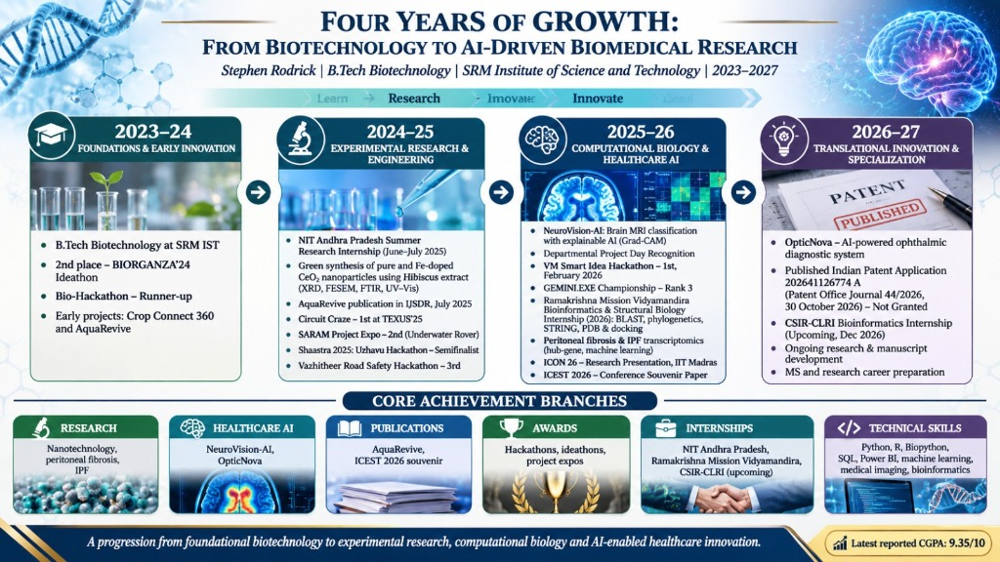
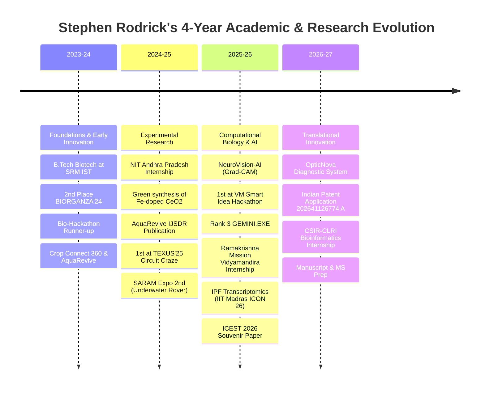

# Stephen Rodrick — Biotechnology × AI Portfolio

<div align="center">

[](https://vercel.com)
[](https://react.dev)
[](https://vitejs.dev)
[](https://www.srmist.edu.in)
[](LICENSE)

<br/>

**Bridging foundational biotechnology, computational biology, and AI-enabled healthcare innovation.**

[Live Demo](#-deploy-on-vercel) • [Four-Year Roadmap](#-four-years-of-growth-roadmap) • [Research & Projects](#-core-achievement-branches) • [Vercel Deployment](#-deploy-on-vercel) • [Contact](#-connect--contact)

</div>

---

## 🌟 Overview

Welcome to the personal academic and research portfolio of **Stephen Rodrick**, B.Tech Biotechnology candidate (2023–2027) at **SRM Institute of Science and Technology**, Chennai.

This repository contains the complete source code for Stephen's modern, interactive web portfolio—engineered with **React**, **Vite**, and **custom hardware-accelerated animations**—optimized for zero-configuration deployment on **Vercel**.

> *"Biology, with a new lens: Turning messy, high-dimensional molecular data into actionable scientific insight."*

---

## 🗺️ Four Years of Growth Roadmap

The diagram below encapsulates the evolutionary progression across experimental research, computational transcriptomics, medical AI, and translational patents:

<div align="center">
  
</div>

<div align="center">
  <sub><b>Figure 1:</b> Academic and Research Timeline (2023–2027) — Learn ➔ Research ➔ Innovate ➔ Specialize. Reported CGPA: <b>9.35 / 10.0</b>.</sub>
</div>

---

## 🚀 The Four-Year Journey



### 🔬 1. Foundations & Early Innovation (2023–24)
- **Academic Foundation:** Commenced B.Tech in Biotechnology at SRM Institute of Science and Technology.
- **BIORGANZA'24 Ideathon:** Secured **2nd Place** with innovative bio-engineering solutions.
- **Bio-Hackathon:** Awarded **Runner-up**.
- **Early Projects:** 
  - *Crop Connect 360* — Agritech sensor-driven platform.
  - *AquaRevive* — Algae-based biofilter system for greywater purification.

### 🧪 2. Experimental Research & Engineering (2024–25)
- **NIT Andhra Pradesh Summer Research Internship:** Experimental nanomaterial synthesis and characterization (June–July 2025).
- **Nanotechnology:** Green synthesis of pure and $\text{Fe}$-doped $\text{CeO}_2$ nanoparticles using *Hibiscus* extract, evaluated via XRD, FESEM, FTIR, and UV-Vis spectroscopy.
- **Peer-Reviewed Publication:** *AquaRevive: Algae-Based Biofilter System for Greywater Purification*, published in **IJSDR** (July 2025).
- **Competitions & Expos:**
  - **1st Place:** Circuit Craze at TEXUS'25.
  - **2nd Place:** SARAM Project Expo (Autonomous Underwater Rover).
  - **Semifinalist:** Shaastra 2025 Uzhavu Hackathon (IIT Madras).
  - **3rd Place:** Vazhitheer Road Safety Hackathon.

### 🧠 3. Computational Biology & Healthcare AI (2025–26)
- **NeuroVision-AI:** Deep learning classification of brain MRI scans with explainable AI (Grad-CAM heatmaps for clinician validation).
- **Ramakrishna Mission Vidyamandira Internship:** Bioinformatics & Structural Biology (BLAST, phylogenetics, STRING interaction networks, PDB modeling, and molecular docking).
- **Transcriptomics Research:** Peritoneal fibrosis and Idiopathic Pulmonary Fibrosis (IPF) cross-cohort discovery combining machine learning, hub-gene identification, and multi-organ expression matrices.
- **Conferences & Honors:**
  - **1st Place:** VM Smart Idea Hackathon (February 2026).
  - **Rank 3:** GEMINI.EXE Championship.
  - **Research Presentation:** ICON 26 at IIT Madras.
  - **Publication:** ICEST 2026 Conference Souvenir Paper.
  - **Departmental Recognition:** SRM IST Project Day Honor.

### 💡 4. Translational Innovation & Specialization (2026–27)
- **OpticNova:** AI-powered ophthalmic diagnostic system for automated fundus photography analysis, biomarker quantification, and diabetic retinopathy grading.
- **Published Patent Application:** Indian Patent Application `202641126774 A` (Published in Patent Office Journal `44/2026` on 30 October 2026) — *AI-Powered Medical Diagnostic Workflow*.
- **CSIR-CLRI Bioinformatics Internship:** Advanced computational biology internship at Central Leather Research Institute, Chennai.
- **Research Career Focus:** Manuscript development, high-impact journal submissions, and graduate research (MS / Ph.D.) preparation.

---

## 🎯 Core Achievement Branches

| Branch | Highlights & Contributions |
| :--- | :--- |
| **🔬 Research** | Green nanomaterials ($\text{CeO}_2$), cross-organ peritoneal fibrosis transcriptomics, IPF biomarker validation. |
| **🧠 Healthcare AI** | *NeuroVision-AI* (Explainable MRI triage), *OpticNova* (Automated ophthalmic fundus screening). |
| **📚 Publications & IP** | Published in *IJSDR*, *ICEST 2026*, and Indian Patent Application `202641126774 A`. |
| **🏆 Awards** | 1st @ VM Smart Idea Hackathon, 1st @ TEXUS'25 Circuit Craze, Top 3 @ GEMINI.EXE, 2nd @ SARAM Expo. |
| **🏛️ Internships** | CSIR-CLRI (Bioinformatics), NIT Andhra Pradesh (Nanomaterials), Ramakrishna Mission Vidyamandira. |
| **💻 Technical Stack** | Python, R, Biopython, PyTorch, TensorFlow, OpenCV, SQL, Power BI, Scikit-learn, Molecular Docking. |

---

## 🛠️ Tech Stack & Architecture

This portfolio website is designed with a minimalist, high-performance architecture:

```
portfolio-of-mine-/
├── assets/                       # Static media & roadmap infographic for GitHub
│   └── four-years-of-growth.jpg
├── public/                       # Static public assets served directly by Vite / Vercel
│   ├── four-years-of-growth.jpg
│   ├── resume.pdf
│   └── Stephen_Rodrick_Resume.pdf
├── src/
│   ├── App.jsx                  # Main application container, router, and sections
│   ├── ProjectDetail.jsx        # Detailed case-study modal & deep-dive view
│   ├── projects.js              # Comprehensive project metadata & research specs
│   ├── styles.css               # Typography, custom CSS variables, and fluid grids
│   └── main.jsx                 # React root hydration
├── index.html                   # HTML entry point with preconnected typography
├── package.json                 # Project dependencies and Vite build scripts
├── vercel.json                  # Production Vercel deployment & routing configuration
└── vite.config.js               # Optimized Vite bundler configuration with React plugin
```

### Highlights:
- **Zero-Dependency Hash Routing:** Fast, flicker-free routing that operates smoothly on static web hosts.
- **Fluid Cursor Physics:** Pointer-reactive fluid trailing canvas with motion-preference detection (`prefers-reduced-motion`).
- **Dark Scientific Aesthetic:** Inspired by laboratory notebooks, optical microscopy grids, and bioinformatics data visualizers.

---

## 🚀 Deploy on Vercel

The repository is pre-configured with a production-ready [`vercel.json`](./vercel.json) file for one-click deployment.

### Option 1: Deploy with Vercel Web Dashboard (Recommended)

1. Push your repository to GitHub (or use [stephenrodrick17-cloud/portfolio-of-mine-](https://github.com/stephenrodrick17-cloud/portfolio-of-mine-)).
2. Go to [vercel.com](https://vercel.com) and log in.
3. Click **"Add New Project"** and select **"Import Git Repository"**.
4. Select `portfolio-of-mine-`.
5. Vercel automatically detects **Vite**:
   - **Framework Preset:** `Vite`
   - **Build Command:** `npm run build`
   - **Output Directory:** `dist`
6. Click **"Deploy"**. Your site will be live within seconds!

### Option 2: Deploy using Vercel CLI

```bash
# 1. Install the Vercel CLI globally (if not already installed)
npm install -g vercel

# 2. Authenticate and deploy
vercel

# 3. For production release:
vercel --prod
```

---

## 💻 Local Development Setup

To run the portfolio locally on your machine:

```bash
# 1. Clone the repository
git clone https://github.com/stephenrodrick17-cloud/portfolio-of-mine-.git
cd portfolio-of-mine-

# 2. Install dependencies
npm install

# 3. Start local development server
npm run dev

# 4. Create production build
npm run build

# 5. Preview the production build locally
npm run preview
```

The application will be available at `http://localhost:3000`.

---

## 📬 Connect & Contact

- **Name:** Stephen Rodrick
- **Degree:** B.Tech in Biotechnology (Class of 2027)
- **Institution:** SRM Institute of Science and Technology, Chennai, India
- **Email:** [sr5145@srmist.edu.in](mailto:sr5145@srmist.edu.in)
- **LinkedIn:** [linkedin.com/in/stephenrodrick](https://www.linkedin.com/in/stephenrodrick)
- **GitHub:** [github.com/stephenrodrick17-cloud](https://github.com/stephenrodrick17-cloud)

---

<div align="center">
  <sub>© 2026 Stephen Rodrick. Designed & built with curiosity, data, and precision.</sub>
</div>
